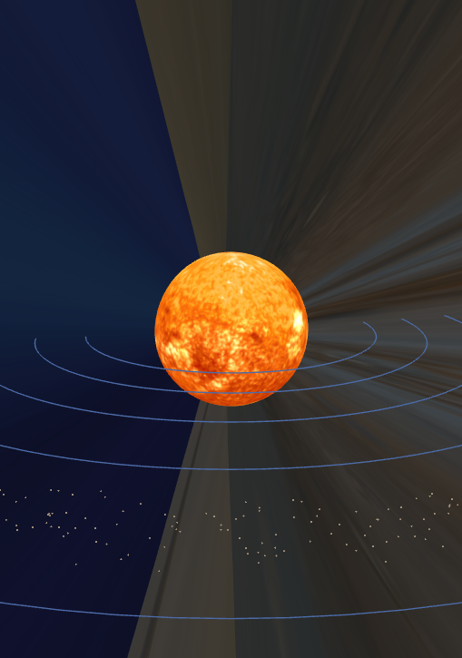
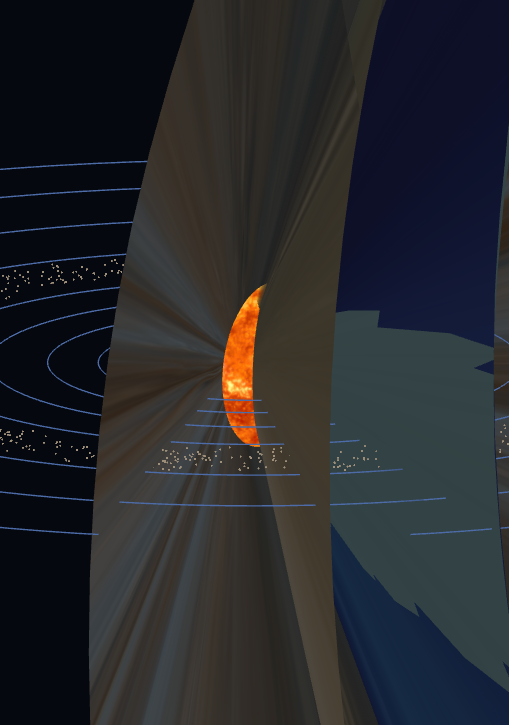
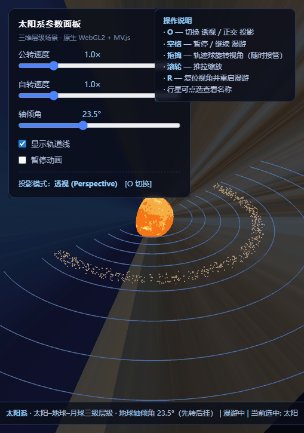

# AP2 · 三维层级场景：太阳系

> 原生 **WebGL 2.0** + **JavaScript**，使用教材配套工具库 `Common/`（`initShaders.js`、`MV.js`、`webgl-utils.js`）。无构建步骤，任意静态服务器即可运行。

本项目实现"太阳–地球–月球"三级层级建模，并扩展为完整太阳系。重点在于：用**矩阵逐层相乘**表达"物体在物体之上"的变换依赖；其中地球自转轴 **23.5° 倾角**采用"**先转后挂**"（先在自身模型矩阵上施加倾角旋转，再叠加公转轨道变换）；月球轨道面倾角使用**手写的 `mat4` 基本变换**组合（对应教材 Ch4 的变换推导）。

---

## 一、运行方式

1. 本地运行（任选其一）：
   ```bash
   # 在项目根目录执行
   python -m http.server 8000
   # 或任意静态服务器，然后浏览器打开
   # http://localhost:8000/index.html
   ```
2. 公网访问：*（部署至 GitHub Pages 等平台后在此填入 URL）*

---

## 二、功能清单

**必做（Baseline）**
- ✅ 太阳–地球–月球三级层级嵌套（模型矩阵逐层相乘）
- ✅ 地球绕太阳公转 + 自转；月球绕地球公转；**地球自转轴倾斜 23.5°（先转后挂）**
- ✅ 手动矩阵：月球轨道面倾角用自写 `mat4` 基本变换组合（`makeRotateX` 等），见第四节
- ✅ 表面纹理：太阳、地球、月球各贴位图纹理；处理地球纹理上下颠倒（`UNPACK_FLIP_Y_WEBGL`）
- ✅ `O` 键切换 透视/正交 投影，同场景对比
- ✅ 相机漫游：预设环绕路径 + 关键帧插值，空格暂停/继续，可与鼠标拖拽随时互相接管
- ✅ 参数面板：公转速度、自转速度、轴倾角滑条；轨道线显示开关

**选做（Extension）**
- ✅ **E1**：完整太阳系（8 颗行星 + 土星环 + 小行星带）
- ⬜ **E2**：日食 / 月食模拟（未实现）
- ✅ **E3**：虚拟轨迹球（教材 Virtual Trackball 思想）实现视角控制

---

## 三、层级结构与变换嵌套树

场景以太阳为根，行星挂于太阳之下，月球（仅地球）挂于地球之下。每层节点的**世界矩阵** = `父世界矩阵 × 节点自身变换`，通过 `drawNode(node, parentModel, t)` 递归逐层相乘（详见 `main.js` 的 `drawNode`）。

```
drawNode(太阳, mat4(), t)                      // 根：单位矩阵
│
├─ drawNode(水星, 太阳世界矩阵, t)
├─ drawNode(金星, 太阳世界矩阵, t)
├─ drawNode(地球, 太阳世界矩阵, t)
│   │
│   └─ drawMoon(月球, 地球世界矩阵, t)          // 月球挂在地球之下
├─ drawNode(火星, 太阳世界矩阵, t)
├─ drawNode(木星, 太阳世界矩阵, t)
├─ drawNode(土星, 太阳世界矩阵, t)              // 含土星环
├─ drawNode(天王星, 太阳世界矩阵, t)
└─ drawNode(海王星, 太阳世界矩阵, t)
```

**各节点自身变换（先转后挂，变换顺序决定结构）**

```
太阳：  R_y(自转) × S(radius)
行星：  T(公转位置) × S(radius) × R_x(轴倾角°) × R_y(自转)     ← 先转后挂
月球：  earthWorld × R_x(轨道面倾角5.1°) × T(0.42,0,0) × S(0.048) × R_y(自转)
```

> **先转后挂的含义**：轴倾角 `R_x` 在公转平移 `T` 之前施加，旋转先作用于局部坐标系（自转轴随之倾斜），再被 `T` 整体搬移到轨道位置。若顺序颠倒（先平移再倾角），倾角会改绕太阳系原点旋转，结构错误——这正是"变换顺序决定结构"的体现。

---

## 四、手动矩阵构造（教材 Ch4 推导）

要求至少一处运动**不**用工具库封装的复合函数，而用 `MV.js` 的 `mat4` 基本变换手工构造。本项目中**月球轨道面倾角**使用自写的 `makeRotateX` 手动构造并组合。

### 4.1 绕 X 轴旋转 `R_x(θ)`

取 x 轴为旋转轴，`x` 分量不变，`y`、`z` 在 yz 平面旋转 θ。由旋转的几何关系（Ch4 旋转推导）得列主序矩阵：

```
        ⎡1    0     0    0⎤
R_x(θ) = ⎢0  cosθ  -sinθ 0⎥      (列主序)
        ⎢0  sinθ   cosθ 0⎥
        ⎣0    0     0    1⎦
```

对应代码：
```js
function makeRotateX(theta) {
  const c = Math.cos(theta), s = Math.sin(theta);
  return mat4(1, 0, 0, 0,  0, c, s, 0,  0, -s, c, 0,  0, 0, 0, 1);
}
```

### 4.2 绕 Y 轴旋转 `R_y(θ)`（自转用）

`y` 分量不变，`x`、`z` 在 xz 平面旋转：

```
        ⎡cosθ  0  sinθ 0⎤
R_y(θ) = ⎢ 0    1   0   0⎥      (列主序)
        ⎢-sinθ 0  cosθ 0⎥
        ⎣ 0    0   0   1⎦
```

### 4.3 平移 `T(x,y,z)`

```
        ⎡1 0 0 x⎤
T(x,y,z)= ⎢0 1 0 y⎥      (列主序)
        ⎢0 0 1 z⎥
        ⎣0 0 0 1⎦
```

### 4.4 组合（月球轨道面倾角）

月球先在自身参考系绕 X 轴倾斜轨道面，再平移至绕地球的轨道位置、自转、缩放，最后被地球世界矩阵搬运。组合逻辑：

```js
const moonLocal = mult(scalem(moon.radius, moon.radius, moon.radius),
                       makeRotateY((t / moon.spin) * 2 * Math.PI));     // 自转
const model = mult(earthWorld,
                 mult(makeRotateX(moon.tilt * Math.PI / 180),            // 手动矩阵：轨道面倾角
                      mult(makeTranslate(pos[0], pos[1], pos[2]), moonLocal))); // 平移 + 自转
```

其中 `makeTranslate`、`makeRotateX`、`makeRotateY` 均为手写 `mat4`，通过 `MV.js` 的 `mult` 逐层相乘，与教材 Ch4 的变换推导一致。

---

## 五、表面纹理与上下颠倒处理

- 太阳、地球、月球（以及全部 8 行星、土星环）均使用位图纹理。
- 每颗天体上传纹理的流程：`new Image()` → `onload` → `gl.createTexture()` → `gl.bindTexture()` → `gl.texImage2D(gl.TEXTURE_2D, 0, ...)` → 设置 `S/T` 环绕与 `MIPMAP`/`LINEAR` 过滤。
- **地球纹理上下颠倒问题**：GLSL 中纹理坐标 `(0,0)` 位于纹理图片左下角，而浏览器 `Image` 的 `(0,0)` 位于左上角，直接上传会让地球纹理上下颠倒。解决方式是在 `texImage2D` 前调用：
  ```js
  gl.pixelStorei(gl.UNPACK_FLIP_Y_WEBGL, true);   // 上传时翻转 Y，使 UV 方向一致
  ```
  本项目在 `loadTexture` 中对行星/月球等"非环"纹理开启该标志，从而避免上下颠倒。

---

## 六、双投影对比（透视 vs 正交）

按 `O` 键在同一场景、同一视角下切换两种投影：

| | 透视投影（Perspective） | 正交投影（Orthographic） |
|---|---|---|
| 截图 |  |  |
| 近大远小 | ✅ 远处天体变小 | ❌ 大小不随距离变化 |
| 平行线 | 平行线在远处汇聚 | 平行线始终平行 |
| 观察效果 | 更有深度、符合人眼 | 保留真实比例，适合测量/构图 |

- **透视投影**：`perspective(fovy, aspect, near, far)`，顶点经投影后产生近大远小。
- **正交投影**：`ortho(-w, w, -h, h, near, far)`，视体为长方体，x、y 直接线性映射到裁剪空间，无透视收缩。
- 上图为同一近景视角下的对比：透视图中太阳/轨道近处更大、远处更小；正交图中各天体大小与距离无关。

---

## 七、相机漫游

- 预设路径：绕场景一周的圆形轨迹 + 高度起伏（`TOUR = { radius: 17, height: 5, amp: 5, periodSec: 12 }`），相机位置按关键帧插值：`x = r·cos(a), z = r·sin(a), y = h + amp·sin(3πt)`。
- **空格**：暂停 / 继续 漫游。
- **拖拽**：随时接管为自由视角（虚拟轨迹球），松开后可用 `R` 复位并重启漫游（0.8s 平滑过渡 blend 回漫游路径）。
- 漫游录屏（约 10 秒，GIF）：

  

---

## 八、参数面板与交互

| 控件 | 作用 |
|---|---|
| 公转速度滑条 | 调整整体公转速度倍数（`orbitFactor`） |
| 自转速度滑条 | 调整行星自转速度倍数（`spinFactor`） |
| 轴倾角滑条 | 实时调整地球轴倾角（`tiltOverride`，演示"先转后挂"） |
| 显示轨道线开关 | 轨道线 `LINE_LOOP` 的显示/隐藏 |
| 暂停动画开关 | 停止/恢复天体运动 |

快捷键：`O` 投影切换 · `空格` 漫游暂停/继续 · `R` 复位视角 · `拖拽` 轨迹球 · `滚轮` 缩放 · `点选` 查看行星名称。

---

## 九、选做扩展

- **E1 完整太阳系**：`SYSTEM` 集中配置 8 颗行星（半径/轨道/周期/自转/倾角，负 `spin` 表示逆向自转），土星带透明环（`BLEND + depthMask(false)` + alpha 纹理），小行星带 1200 个点精灵绕太阳公转。
- **E3 虚拟轨迹球**：屏幕位移 `(dx,dy)` → 绕相机系轴的旋转角（`rotateVec(dir, axis, angle)`），实现直观的轨道拖拽旋转。
- E2 日食/月食：未实现。

---

## 十、引用与来源

- 工具库 `Common/`（`initShaders.js`、`MV.js`、`webgl-utils.js`）：来自教材配套仓库（github `esangel/WebGL`），按教材使用方式通过 `<script type="x-shader/...">` 读取着色器。
- 位图纹理：来自 [Solar System Scope](https://www.solarsystemscope.com/textures/)（CC BY 4.0），下载后存放于 `textures/`。
- 土星环纹理：因源站下载失败，使用 PowerShell + System.Drawing 程序生成的 1024×128 径向剖面 alpha 环纹理（`textures/saturn_ring.png`）。
- 虚拟轨迹球：参考教材 *Interactive Computer Graphics*（Virtual Trackball）思想自行实现。
- 本项目代码为独立撰写；引用/参考的外部代码与素材已在上述列出。

---

## 目录结构

```
solar-system/
├── index.html        # 页面 + UI 面板 + 内嵌着色器
├── main.js           # 全部场景逻辑（层级、矩阵、纹理、投影、漫游、交互）
├── Common/           # 教材工具库（initShaders.js / MV.js / webgl-utils.js）
├── textures/         # 位图纹理（太阳/8行星/月球/土星环）
├── screenshots/      # 截图（透视 / 正交 对比等）
└── README.md
```
